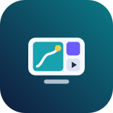
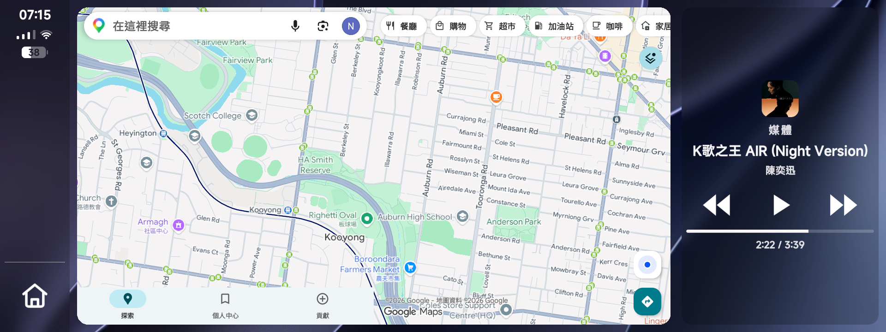
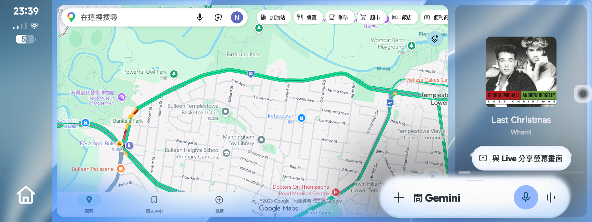
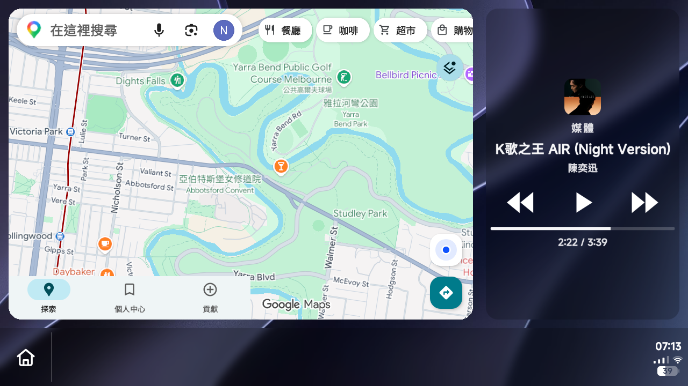
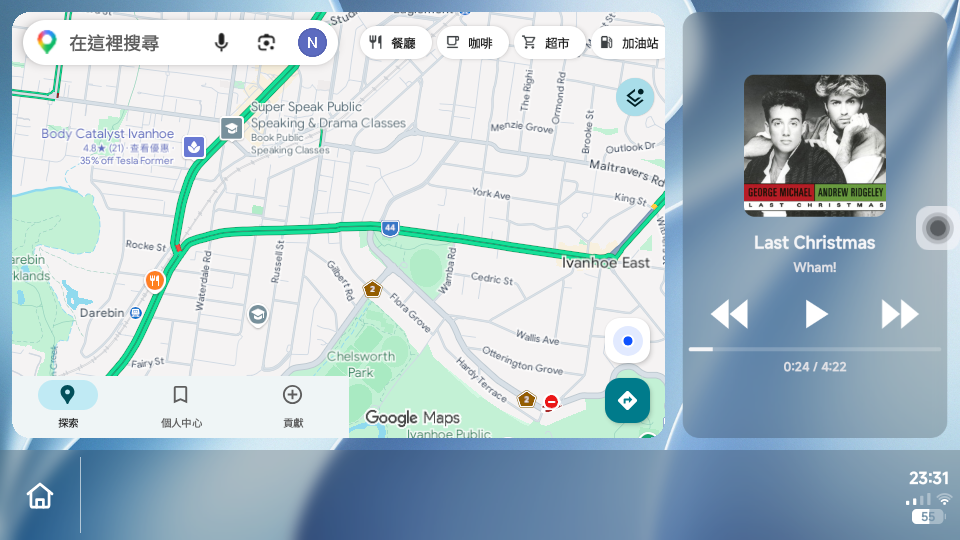
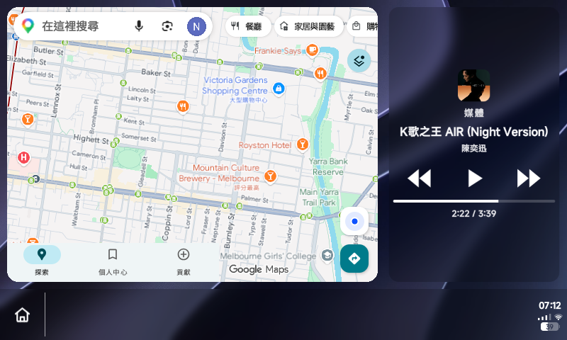
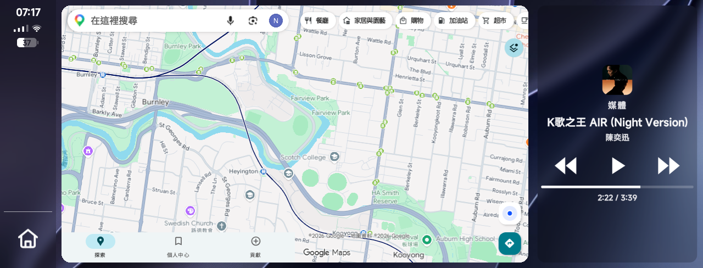
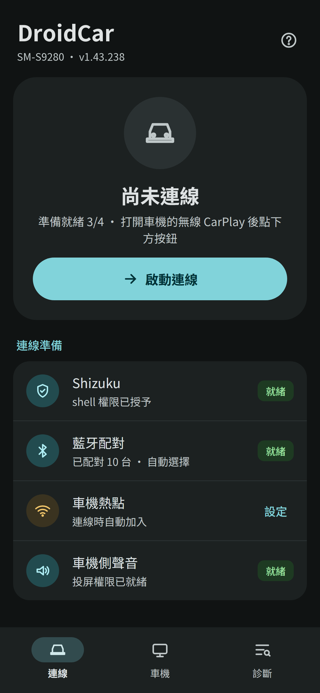

<p align="center">
  
</p>

<h1 align="center">CarDeck Neo</h1>

<p align="center">
  讓 Android 手機以無線 CarPlay 連上車機，顯示地圖、音樂與 App 的車機桌面<br>
  <b>繁體中文</b> · <a href="README.zh-CN.md">简体中文</a> · <a href="README.en.md">English</a>
</p>

---

CarDeck Neo 是 [CarDeck](https://github.com/shaonialife/cardeck) 的介面改版。手機（不需 root）扮演 CarPlay 發送端，把自繪的車機桌面與手機上的 App 投到支援無線 CarPlay 的車機上，車機觸控再回傳到手機操作。

> **非官方專案**：與 Apple Inc. 及任何汽車製造商無關，未獲授權或認證，**不是 MFi 產品**。CarPlay / AirPlay 是 Apple Inc. 的商標，僅用於說明相容目標。
>
> **駕駛安全**：只在停車時連線與設定；行駛中可能斷線，請以原廠導航作為安全備援。完整條款見 [DISCLAIMER.md](DISCLAIMER.md)。

## 畫面預覽

### 車機

<p align="center">
  
  <br><sub>儀表板：左邊地圖可直接操作，右邊音樂控制（1920×720）</sub>
</p>

<p align="center">
  
  <br><sub>說「Hey Google」，Gemini 直接顯示在車機上，可觸控操作（實驗性）</sub>
</p>

### 不同解析度與比例

版面會依車機解析度自動調整：寬螢幕左右分屏，窄螢幕把 Dock 移到底部，讓地圖有更多空間。

| 1280×720（16:9） | 960×540（16:9） |
| :---: | :---: |
|  |  |
| **800×480（5:3）** | **1280×488（8:3）** |
|  |  |

### 手機

<p align="center">
  
  <br><sub>手機主頁（Material Design 3，深淺色跟隨手機、主色跟隨系統桌布）</sub>
</p>

## 功能

- **儀表板**：連線後直接進入地圖與音樂分屏。地圖卡可以直接拖動、縮放；從儀表板往左拖可翻到應用頁，頁面跟著手指移動。翻頁時不會誤觸音樂卡。
- **依解析度自動排版**：寬螢幕（如 1920×720）左右分屏；窄螢幕（如 800×480、16:9）預設 Dock 在底部，也可以在設定改回左右分屏。
- **地圖**：記住最後使用的地圖 App，下次連線沿用；也可以在 **車機設定 → 預設地圖** 手動選擇任何已安裝的 App。
- **音樂**：點音樂卡開啟音樂 App；方向盤媒體鍵可切歌。
- **聲音走車機**：Shizuku 就緒時直接擷取系統播放的聲音，不需要螢幕錄製授權彈窗；只擷取播放的聲音，不使用麥克風。
- **Gemini 上車（實驗性）**：說「Hey Google」時，Gemini 的浮層與動畫直接顯示在車機上，可觸控操作。
- **Dock**：顯示時間、訊號、Wi-Fi 與電量（充電時顯示綠色），背景應用可從主畫面的「背景應用」切換或關閉。
- **車機桌布**：內建多款桌布，深色與淺色模式可分別設定，跟隨手機自動切換；也能從相簿選圖。
- **手機介面**：Material Design 3，底部分為「連線 / 車機 / 診斷」三頁；深淺色跟隨手機，主色跟隨系統。
- **多語言**：繁體中文、簡體中文、英文，可在 **車機設定 → 顯示 → 語言** 切換。
- **車機畫面截圖**：在「診斷」頁一鍵把目前車機畫面存成 PNG（存到「下載/CarDeck」）。

## 需求

- Android 12 以上的手機（「應用橫屏」功能需要 Android 14 以上）
- 已安裝並啟動 [Shizuku](https://shizuku.rikka.app/)（以無線偵錯啟用，不需 root）。虛擬螢幕、觸控注入與聲音擷取都經由它完成，未就緒時無法連線
- 支援無線 CarPlay 的車機，且手機已與車機完成藍牙配對

## 使用方式

1. 安裝 CarDeck Neo，首次開啟時閱讀並接受免責聲明。
2. 啟動 Shizuku，並在 CarDeck Neo 主頁授權。
3. 在車機上打開無線 CarPlay（配對模式），回到手機點 **啟動連線**。
4. 連線後車機會顯示儀表板。車機相關設定可在手機「車機」頁或車機上的設定 App 調整。

## 從原始碼建置

需要 JDK 17 與 Android SDK。在專案根目錄執行：

```powershell
.\gradlew.bat :app:assembleStandardDebug
```

```powershell
.\gradlew.bat :app:testStandardDebugUnitTest :app:lintStandardDebug
```

偵錯版 APK 位於 `app/build/outputs/apk/standard/debug/`。安裝前請先停止正在執行的 App（連線中直接安裝，系統確認視窗可能會跑到車機畫面上）：

```bash
adb shell am force-stop io.github.ezn24.cardeck.neo
```

```bash
adb install -r app/build/outputs/apk/standard/debug/app-standard-debug.apk
```

詳細操作與驗證方式見 [儀表板使用說明](docs/DASHBOARD-UX.md)；給開發者與 AI 助手的專案約定見 [AGENTS.md](AGENTS.md)。

## 致謝與上游

- 本專案基於 [shaonialife/cardeck](https://github.com/shaonialife/cardeck)。上游的協定研究、開發紀錄與測試台搭建說明保存在 [docs/UPSTREAM-README.md](docs/UPSTREAM-README.md)，協定細節見 [docs/PROTOCOL-NOTES.md](docs/PROTOCOL-NOTES.md)。
- 上游 CarDeck 原版下載見 [上游 Releases](https://github.com/shaonialife/cardeck/releases/latest)。

## 授權

[MIT License](LICENSE)。使用前請閱讀 [DISCLAIMER.md](DISCLAIMER.md)。
